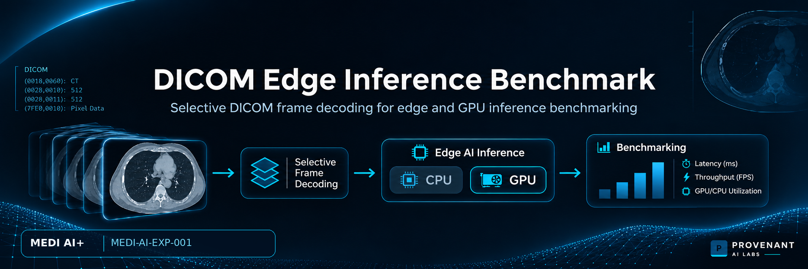

<p align="center">
  
</p>

# DICOM Edge Inference Benchmark

**MEDI AI+ Research Programme**

**Experiment:** `MEDI-AI-EXP-001`

**Author:** Swapin Vidya

**Affiliation:** Provenant AI Labs Pte. Ltd., Singapore

This repository contains a reproducible research experiment within the MEDI AI+ engineering programme at Provenant AI Labs. It investigates whether selective DICOM frame decoding improves end-to-end image ingestion and downstream CPU/CUDA inference performance.

The benchmark evaluates repeated decoding, selective decoding, and bounded prefetching using synthetic medical imaging data. It is research-only and is not a clinical diagnostic system.

## Research question and hypotheses

The primary question is whether retrieving and decoding only the required DICOM frames reduces CPU-side processing overhead and improves end-to-end inference latency.

The secondary hypothesis is that bounded prefetching may overlap CPU decoding with downstream inference, but queueing and scheduling overhead must be measured rather than assumed to help.

## Experimental methodology

All strategies use the same selected frames, decoding backend, batch size, model, and device within each comparison:

- **A - Repeated individual-frame decoding:** retrieve each selected frame independently with `ImageFileReader.read_frame(i)`.
- **B - Selective decoding:** retrieve selected frames in bounded chunks with `ImageFileReader.read_frames(indices=...)`.
- **C - Selective decoding with bounded prefetching:** use the same chunks with a bounded producer queue while inference processes earlier chunks.

The `highdicom` backend evaluates the selective multi-frame API. The `pydicom` backend is a decoding-only harness smoke test and is not evidence about highdicom performance.

## Verified Kaggle GPU pilot

The initial pilot completed on 17 November 2026 using GPU 0 of a Kaggle NVIDIA Tesla T4 instance:

| Item | Value |
| --- | --- |
| CUDA | 13.0 |
| PyTorch | 2.11.0+cu130 |
| Inputs | Synthetic DICOM only |
| Frame data | 96 frames, 128 x 128 pixels |
| Selection | `uniform:16` |
| Warmups / repeats | 1 / 2 |
| Remote tests | 19 passed |
| Local tests | 17 passed, 2 skipped |
| highdicom revision | `d42f664006a9cd2194eda0bf5b1cf0fa2fb0188e` |

### Median end-to-end latency

| Condition | A (ms) | B (ms) | C (ms) | B vs A |
| --- | ---: | ---: | ---: | ---: |
| Native CPU | 34.335 | 29.645 | 30.517 | 13.66% faster |
| Native CUDA | 31.407 | 26.859 | 28.519 | 14.48% faster |
| JPEG CPU | 36.941 | 32.229 | 36.806 | 12.76% faster |
| JPEG CUDA | 34.356 | 31.296 | 33.150 | 8.91% faster |

Selective decoding (B) reduced measured median end-to-end latency by 8.91-14.48% relative to repeated decoding (A) across the four tested Kaggle conditions. Bounded prefetching (C) did not outperform selective decoding alone (B) in this pilot. All decoded-frame hashes matched across methods within each condition.

These results come from a small synthetic pilot. They do not establish universal speedup, clinical performance, medical-device functionality, or energy savings. GPU utilization, power, thermals, and CPU-to-GPU transfer latency were not measured.

## Relationship to MEDI AI+

The experiment evaluates this component path:

```text
DICOM ingestion
    -> selected-frame CPU decoding
    -> CPU/CUDA inference
    -> latency and memory measurements
```

The findings may inform resource-efficient medical image ingestion, edge inference preprocessing, CPU/GPU pipeline performance, future bounded-memory execution, and NVIDIA Jetson deployment research. These are research connections, not proof of the broader MEDI AI+ platform.

The experiment does not claim to implement or validate MEDI AI+ OS-level scheduling, Bio-JERE resource arbitration, GPU-accelerated DICOM decompression, or NVIDIA Jetson performance. See the full experiment record in [docs/MEDI_AI_EXP_001.md](docs/MEDI_AI_EXP_001.md).

## Reproducibility and local setup

Run these commands from the repository root in PowerShell. Use a real Python 3.10+ interpreter; if `python` resolves to a Microsoft Store alias, replace it with the absolute path to an installed interpreter.

```powershell
python --version
python -m venv .venv
& .\.venv\Scripts\python.exe -m pip install --upgrade pip setuptools wheel
& .\.venv\Scripts\python.exe -m pip install -e ".[monitoring,test]"
& .\.venv\Scripts\python.exe -m pip install "git+https://github.com/swapins/highdicom.git@d42f664006a9cd2194eda0bf5b1cf0fa2fb0188e"
& .\.venv\Scripts\python.exe -m pytest -q
```

The validated highdicom API provides `ImageFileReader.read_frames()` and `read_raw_frames()`. Do not modify or push to the upstream highdicom checkout from this project.

### CPU smoke benchmark

This synthetic smoke test does not require CUDA or PyTorch:

```powershell
New-Item -ItemType Directory -Force data,results | Out-Null
& .\.venv\Scripts\python.exe -m dicom_edge_bench generate `
  --out data\smoke.dcm --frames 12 --rows 32 --columns 32
& .\.venv\Scripts\python.exe -m dicom_edge_bench run `
  --dicom data\smoke.dcm --backend highdicom --inference none `
  --device cpu --selection uniform:8 --batch-size 5 --prefetch 2 `
  --repeats 1 --warmups 0 --out results\local_smoke.json
```

Generated DICOM files and benchmark results are ignored by Git. Never use real patient data for this smoke test.

See [the local workflow](docs/LOCAL_VSCODE_KAGGLE_WORKFLOW.md), [the Kaggle protocol](docs/KAGGLE_PROTOCOL.md), and [the experiment protocol](docs/EXPERIMENT_PROTOCOL.md) for the complete reproducibility checklist.

## Kaggle GPU execution

Kaggle is used only for remote GPU execution. The local checkout remains the source of truth.

```powershell
& .\.venv\Scripts\python.exe -m pip install --upgrade kaggle six
& .\.venv\Scripts\kaggle.exe auth login
& .\.venv\Scripts\python.exe scripts\prepare_kaggle_kernel.py `
  --owner YOUR_KAGGLE_USERNAME --profile pilot
& .\.venv\Scripts\kaggle.exe kernels push -p kaggle --accelerator NvidiaTeslaT4
& .\.venv\Scripts\kaggle.exe kernels status `
  "YOUR_KAGGLE_USERNAME/dicom-edge-inference-benchmark"
& .\.venv\Scripts\kaggle.exe kernels logs `
  "YOUR_KAGGLE_USERNAME/dicom-edge-inference-benchmark"
New-Item -ItemType Directory -Force results\kaggle | Out-Null
& .\.venv\Scripts\kaggle.exe kernels output `
  "YOUR_KAGGLE_USERNAME/dicom-edge-inference-benchmark" -p results\kaggle
```

Use only the public Kaggle username in commands. Never add `kaggle.json`, API keys, OAuth tokens, or access tokens to the repository. Do not claim a GPU experiment succeeded based only on upload success.

## Next experiments

The next hardware study should repeat the same A/B/C matrix on the target Jetson platform with a supported JetPack and PyTorch build. Record device model, clocks, CPU/GPU utilization, thermals, power, energy per processed frame, and transfer timing. Raspberry Pi measurements should use a separate supported CPU configuration. Neither platform should be inferred from the Kaggle T4 pilot.

## Authorship and licensing

Author and affiliation: Swapin Vidya, Provenant AI Labs Pte. Ltd., Singapore. See [AUTHORS.md](AUTHORS.md) and [CITATION.cff](CITATION.cff).

This repository is licensed under the MIT License; see [LICENSE](LICENSE). Company affiliation does not assign company intellectual property or trademark rights, and upstream dependencies retain their own licenses.

## Upstream highdicom attribution

This experiment uses the selective multi-frame API from the independent highdicom contribution tracked in [ImagingDataCommons/highdicom PR #520](https://github.com/ImagingDataCommons/highdicom/pull/520), verified at commit `d42f664006a9cd2194eda0bf5b1cf0fa2fb0188e`. This benchmark repository is maintained separately and does not modify that upstream project.
